# Community proposals: revised artwork

These 38 families remain under review in PR #692. The submitted versions are preserved in commit `3036cbd3b06f144556b257b0c05143d71e3e3854`. The revised SVGs were exported individually from the separate Figma review section; the maintained catalogue sections were not modified.

Authorship remains with GrandMagus02 (Grand Magus). Maintainer revisions do not imply contributor approval. No release assets or changeset are included. The contributor has final artwork approval before merge.

Each preview shows the submitted artwork above the revised artwork. Columns: Linear, Broken, Line Duotone, Outline, Bold, Bold Duotone. Paint is rendered in monochrome for comparison; opacity is preserved.

The revisions standardize editable stroke styles and expanded filled styles, stroke weight and duotone treatment where needed. The table explicitly records naming and category changes. It does not claim that every family required every type of adjustment.

| Original name | Revised name | Category | Before / after |
| --- | --- | --- | --- |
| `blend` | `blend` | `tools` | 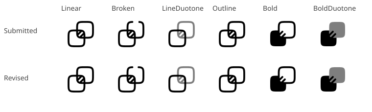 |
| `bring-layer-backward` | `layer-arrow-down` | `tools` | 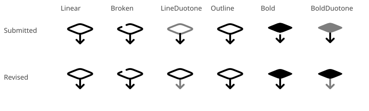 |
| `bring-layer-forward` | `layer-arrow-up` | `tools` | 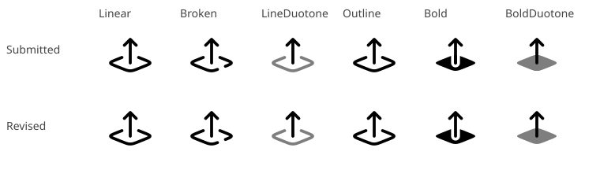 |
| `bring-layer-to-background` | `layers-arrow-down` | `tools` | 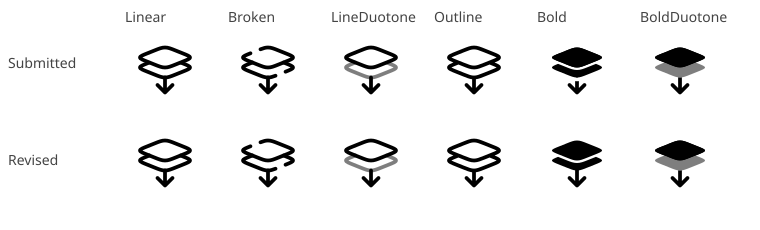 |
| `bring-layer-to-foreground` | `layers-arrow-up` | `tools` | 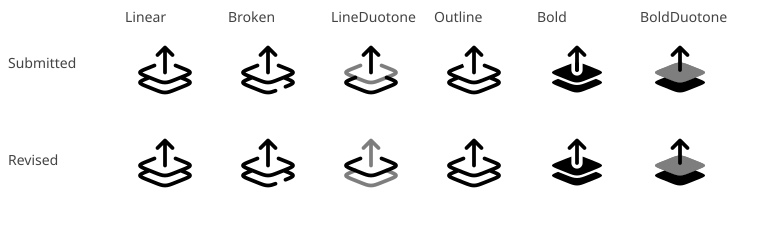 |
| `brush-cross-pen` | `brush-cross-pen` | `tools` | 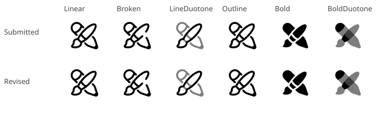 |
| `calendar-range` | `calendar-range` | `time` | 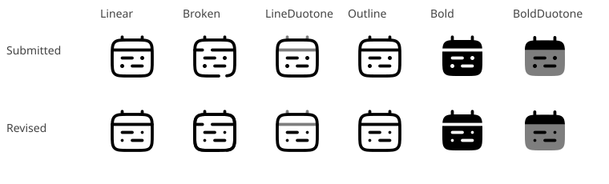 |
| `checkerboard` | `checkerboard` | `tools` | 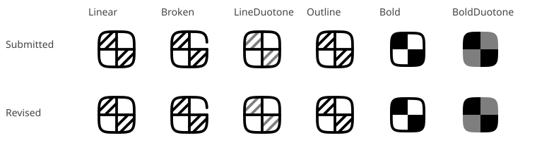 |
| `circle` | `circle` | `tools` | 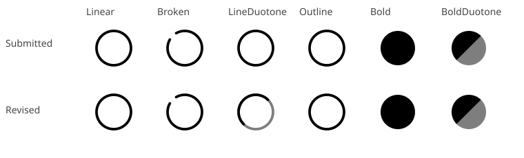 |
| `contrast` | `contrast` | `tools` | 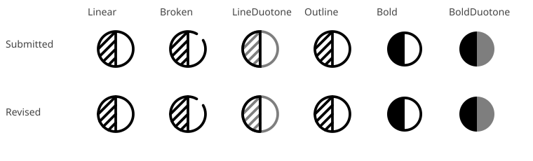 |
| `distort` | `distort` | `tools` | 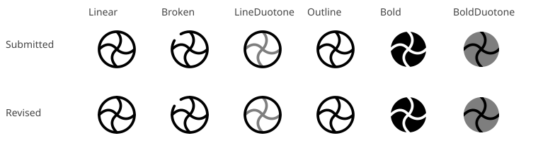 |
| `ellipse` | `ellipse` | `tools` | 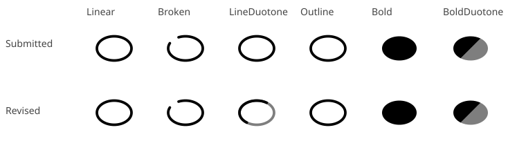 |
| `exclude` | `exclude` | `tools` | 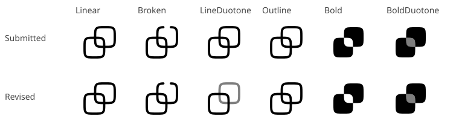 |
| `flat-brush` | `flat-brush` | `tools` | 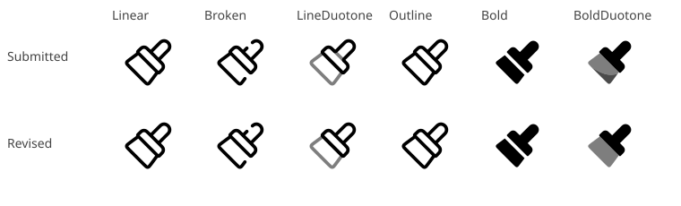 |
| `gradient` | `gradient` | `tools` | 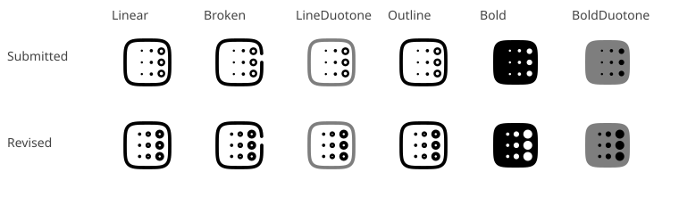 |
| `hand-grab` | `hand` | `hands` | 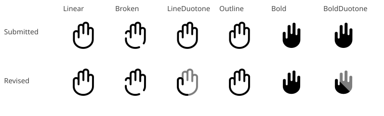 |
| `hand-grabbing` | `hand-grab` | `hands` | 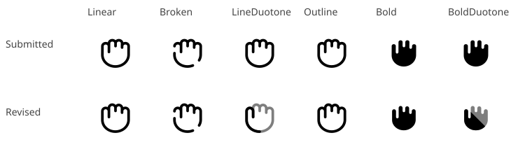 |
| `intersect` | `intersect` | `tools` | 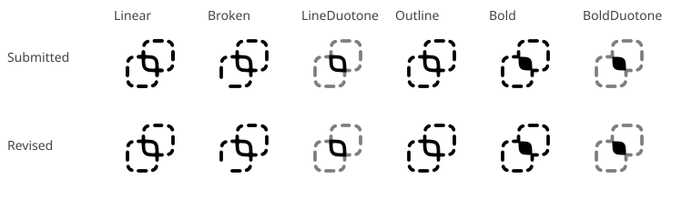 |
| `intersect-minimalistic` | `intersect-minimalistic` | `tools` | 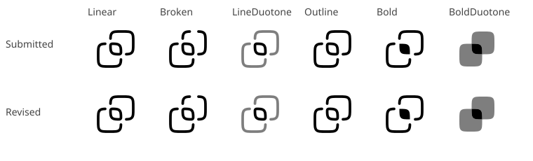 |
| `noise-square` | `noise-square` | `tools` | 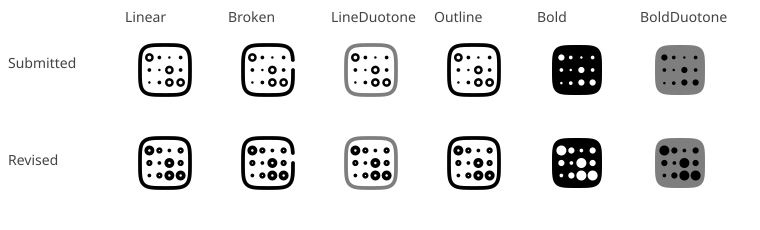 |
| `opacity` | `opacity` | `tools` | 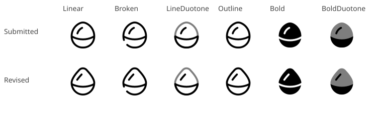 |
| `paint-bucket` | `paint-bucket` | `tools` | 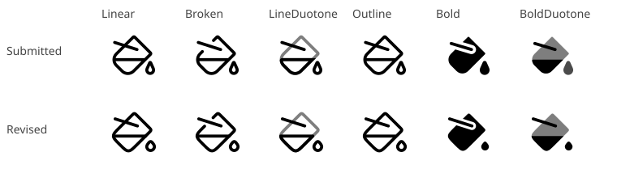 |
| `rectangle` | `rectangle` | `tools` | 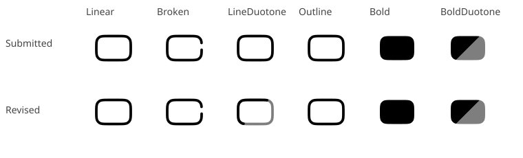 |
| `rotate-anticlockwise` | `rotate-anticlockwise` | `tools` | 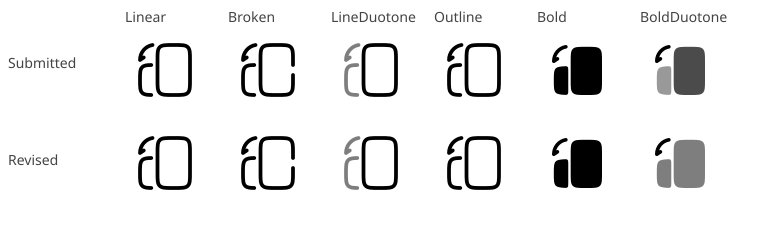 |
| `rotate-anticlockwise-2` | `rotate-anticlockwise-2` | `tools` | 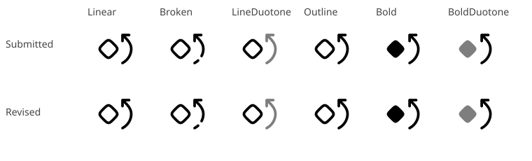 |
| `rotate-clockwise` | `rotate-clockwise` | `tools` | 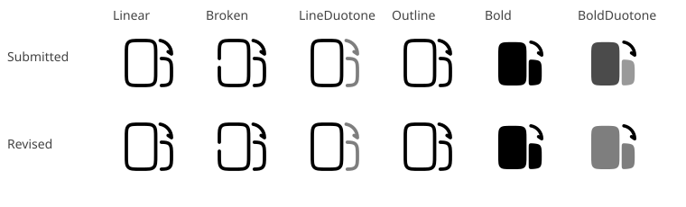 |
| `rotate-clockwise-2` | `rotate-clockwise-2` | `tools` | 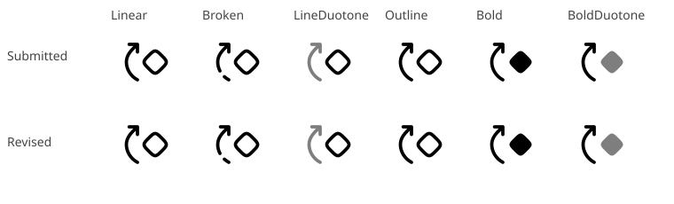 |
| `selection` | `selection` | `tools` | 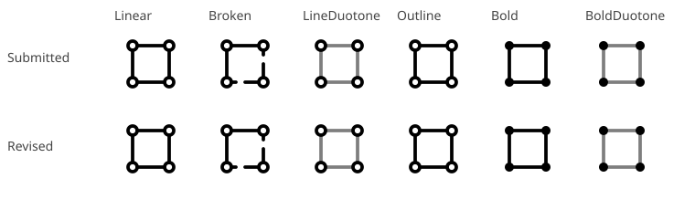 |
| `shadow` | `shadow` | `tools` | 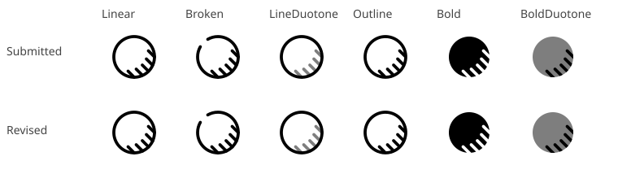 |
| `shape-rotate` | `shape-rotate` | `tools` | 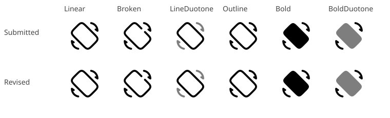 |
| `sparkles` | `sparkles` | `ui` | 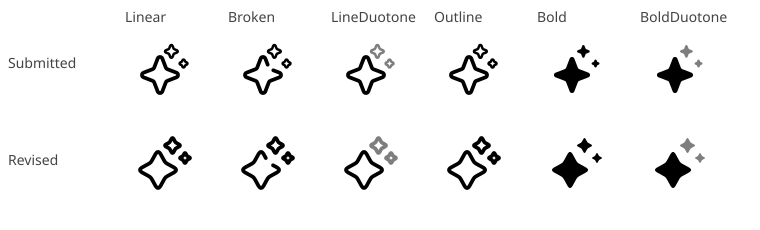 |
| `subtract` | `subtract` | `tools` | 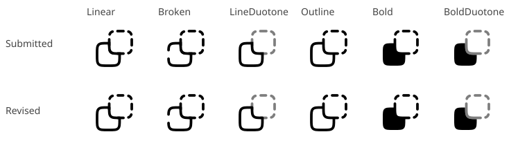 |
| `subtract-minimalistic` | `subtract-minimalistic` | `tools` | 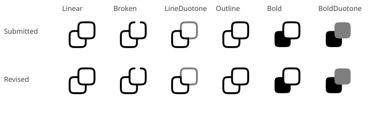 |
| `translate` | `translate` | `text-formatting` | 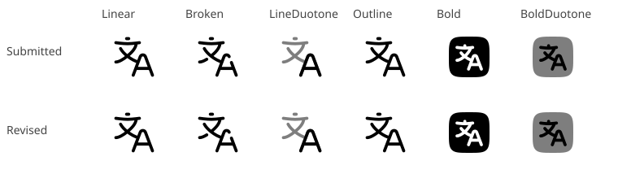 |
| `union` | `union` | `tools` | 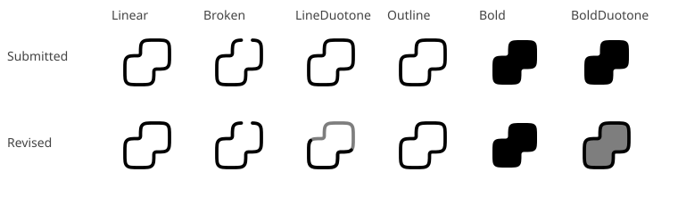 |
| `variable-brackets` | `variable-brackets` | `it` | 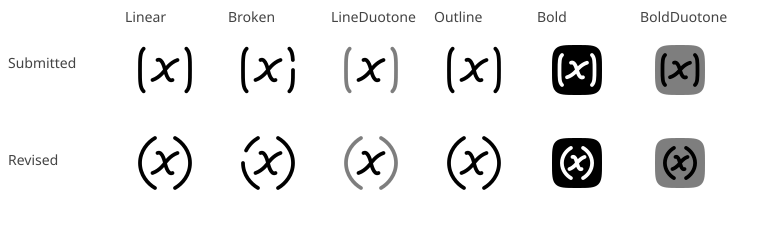 |
| `variable-square` | `variable-square` | `it` | 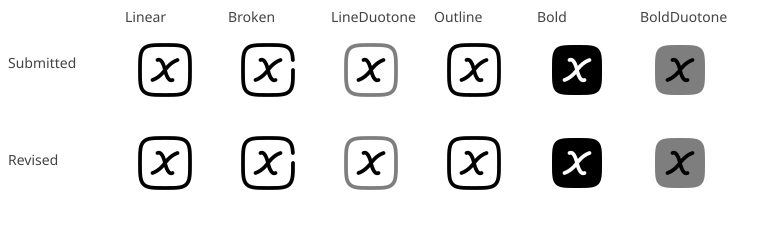 |
| `warp` | `warp` | `tools` | 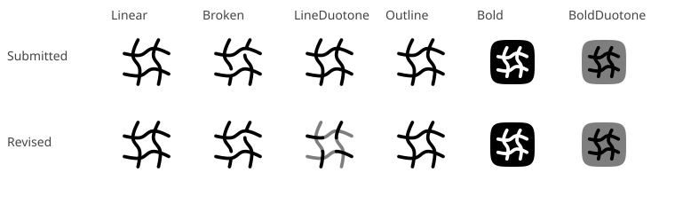 |

## Review boundary

The draft branch deliberately does not regenerate downstream consumers. Existing catalogue-freshness checks may therefore report stale generated files. Once the contributor approves the final artwork, the maintainer can integrate the Figma components into the catalogue categories and prepare the regular export, consumer regeneration and release validation.

## Technical checks

- All 38 families have six 24x24 SVG variants; icon/metadata coverage passes.
- The corrected intersect and paint-bucket variants now pass the stroke-only fill check.
- Theme-resolved black paint was normalized to #1C274C in the review SVGs; geometry and opacity were preserved.
- The strict SVG checker still reports 49 non-round-cap attributes. Forty belong to fully closed paths, where caps have no visible effect. Nine involve open subpaths, including internal junctions, in contrast, exclude, flat-brush, opacity and subtract-minimalistic. These remain explicit follow-up items before integration; no automatic cap changes were applied to the artwork.
- Four warnings belong to the existing WiFi None exceptions, not this proposal batch.

These checks support contributor review, not merge readiness. Downstream generation and final integration checks remain deferred.
